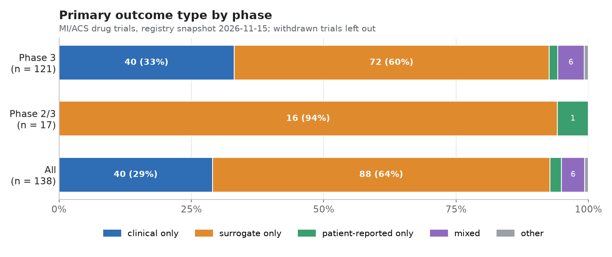
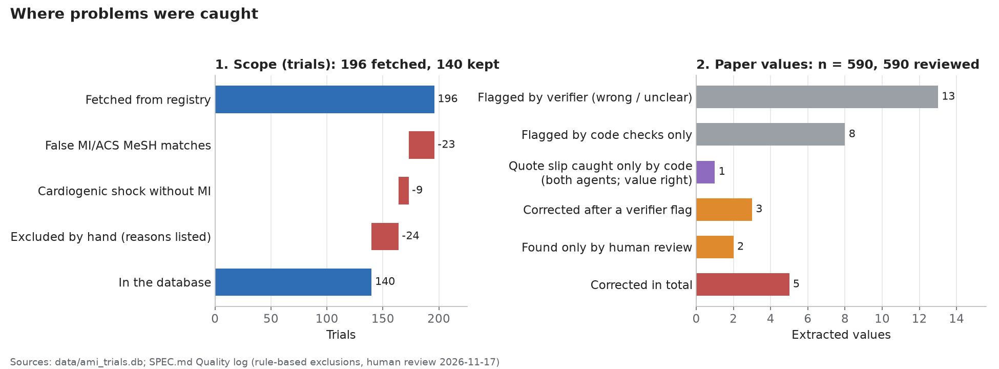

# MI and ACS drug trials: a reviewed database built with AI agents

> **DRAFT** (2026-11-17), not yet approved by the project owner. All numbers come from
> `data/ami_trials.db`, `review/registry_analyses.md` and the Quality log in `SPEC.md` on that
> date.

A SQLite database of **Phase 3 and Phase 2/3 drug trials in MI and ACS patients started on or
after 2010-01-01, labelled by timing (acute / recent / prior MI)**. It currently holds 140 trials,
built from the public ClinicalTrials.gov registry. For a pilot of the 10 largest trials, results
from the published papers were extracted by AI agents, checked by a second agent and by code, and
then reviewed in full by a human.

*Author: Nadav Fertel, medical sciences graduate.*

## Why this project

Registry records say what a trial planned; papers say what it found. Comparing the two at scale
takes careful reading. This project tests a workflow where AI agents do the reading and every
number stays traceable to a page and an exact quote, so a human can check it quickly. The human
reviewer has the final say.

## What is in the database (registry snapshot of 2026-11-15)

| | Trials |
|---|---|
| All | 140 |
| Phase 3 / Phase 2/3 | 122 / 18 |
| Timing after MI: acute / recent / prior | 115 / 18 / 7 |
| Population: STEMI / STEMI + NSTEMI / NSTEMI / ACS mixed / MI unspecified | 64 / 23 / 3 / 41 / 9 |
| Status: completed / terminated / withdrawn / other (recruiting, unknown, ...) | 74 / 7 / 2 / 57 |
| Lead sponsor: industry / academic and other / government | 32 / 102 / 6 |

Each trial carries:
- registry fields: phase, status, dates, enrollment, sponsor, arms, interventions, outcomes,
  countries
- cleaned fields: generic drug names, drug classes, sponsor groups, why-stopped categories,
  primary outcome type, population and timing labels
- a record of where each label came from: a rule, a draft, or owner approved

## Registry findings

From `review/registry_analyses.md` (`scripts/registry_analyses.py`). The 2 withdrawn trials (no
patients enrolled) are left out, so these figures cover 138 trials; the 7 terminated trials are
included and also listed separately.

- **Primary outcome type:** 88 of 138 trials (64%) have only surrogate primary outcomes, such as
  infarct size, biomarkers or imaging. 40 (29%) have only clinical-event primary outcomes.
- **Phase 2/3 trials:** 16 of 17 (94%) have only surrogate primary outcomes; none has only
  clinical-event outcomes.

- **Small surrogate-only trials:** 81 of the 88 surrogate-only trials (92%) enrol fewer than 500
  patients; that is 59% of all 138 trials.
- **Acute-only trials (114):** the picture is similar: 79 (69%) are surrogate-only, and 73 (64%)
  are small surrogate-only trials.
- **Drug classes (study drugs only):** the most tested classes are antiplatelets (35 trials, 25%;
  P2Y12 inhibitors in 32), glucose-lowering drugs (19 trials, 14%; SGLT2 inhibitors in 13),
  anti-inflammatory and lipid-modifying drugs (11 trials each), and anticoagulants and
  fibrinolytics (9 each). Classes use a "parent: mechanism" format reviewed by the owner (73 drugs,
  27 parent classes).
- **Terminated trials (7):** stopped for lack of efficacy or futility (2), COVID-19 (2), a
  healthcare system change (1), an unclear reason (1) or no stated reason (1).

## Paper pilot: results extraction with full human review

The 10 largest completed or terminated trials with a main results paper (11 papers: one
factorial trial has a separate paper for each comparison). 8 of the 10 are industry-sponsored.

**Pipeline, per trial:**

1. **Outcome-checker** (AI agent) reads the paper's primary endpoint on its own, before any
   extraction, for a later check against the registered outcome.
2. **Extractor** (AI agent) pulls the results: N per arm, events, effect size, 95% CI, p-value,
   endpoint definitions, key secondary and safety outcomes. Every value has an exact quote, a page
   number and a confidence level, or is marked "not reported".
3. **Verifier** (AI agent) first finds the key numbers independently, then judges every
   extracted value: confirmed, wrong, not in paper or unclear.
4. **Code checks:** every quote must be found word for word on its stated page of the PDF, and
   the verifier's independent numbers are compared with the extractor's.
5. **Human review** of every value in a spreadsheet; decisions are loaded into the database and
   can never be edited or deleted, only superseded.

**Results:**

| | |
|---|---|
| Values extracted | 590 (73 of them "not reported") |
| Human-reviewed | 590 of 590 (100%) |
| Corrected by the reviewer | 5 |
| Flagged by the verifier or code, then reviewed | 21 (3 needed a correction) |
| Not flagged, but wrong on review | 2 of 569 (0.4%) |

- **The 5 corrections:** No extracted number was incorrect; 2 numbers reported in the paper were missed (recorded as 'not reported') and 3 text values were trimmed to what their quote supports. The 2 missed numbers were denominators printed only in a table
  header (now an explicit rule for both agents); the 3 text values held the agent's own inference
  or a clause from another sentence, while the underlying fact was right.

- **Code catches what two agents miss:** in one trial, the extractor and the verifier dropped the
  same word from the same quote, in two separate runs. Only the code quote check caught it.
- **Agents flag, humans decide:** the verifier marked 13 values wrong or unclear; on review 3 of
  them needed a correction. Its flags point the reviewer to hard cases (e.g. patients excluded
  after randomization), but they are not verdicts.
- **Review changed the rules:** the reviewer's findings became written rules (quotes must
  contain the value and start at the beginning of a sentence; a value contains only what its quote
  says; table-header denominators; how a testing order is read), and the quote checker was fixed
  for two false alarms (en dashes; quotes that resume after a table several pages later).

## How it was built

| Step | What happens | Who |
|---|---|---|
| 1-2 | Download from the ClinicalTrials.gov API, apply the inclusion rules, load into SQLite | Python scripts |
| 2a | Clean drug names, drug classes, sponsors, stop reasons and outcome types: scripts or Claude draft, the owner approves | scripts + owner |
| 2b | Hand-check a random sample of registry values against the website | owner |
| 3 | Pick the 10 largest completed or terminated trials with a main results paper; the owner places the PDFs | owner |
| 3b-5 | Outcome-checker, extractor and verifier (Claude Code agents, `.claude/agents/`) | AI agents |
| 6 | Code checks: quotes word for word on the stated page; independent numbers compared | Python scripts |
| 7-8 | The owner reviews **every** extracted value; decisions are loaded into SQLite | owner + script |

Every decision is written down in `SPEC.md` (36 numbered decisions so far), and every data
problem in its Quality log.

## Quality controls (examples from the Quality log)

- **Registry hand-check:** 0 of 70 sampled registry values were wrong (95% CI 0-5%). Population
  labels had 3 errors in 46 checks. The cause was found in the labelling rules, the rules were
  changed, and every affected label was re-checked.
- **Exclusions:** 196 downloaded trials became 140 after documented exclusion rounds, each trial
  with its reason, for example MI named only as an outcome, or a population with no MI.
- **The registry is not always up to date.** One trial is "completed" in the registry, but its
  paper reports it was stopped early for futility. The paper value is recorded, and the registry
  snapshot is left unchanged.
- **Reviewer decisions are checked against the rules too.** One review decision conflicted with a
  written rule (patients excluded after randomization belong in "N analysed", not "N
  randomized"); it was caught at import and the reviewer reverted it.

## Limitations

- **Snapshot date:** the registry data is a snapshot from 2026-11-15.
- **Drafts without individual review:** of 184 primary-outcome types, 47 were decided
  individually and 137 were high-confidence drafts that went in without individual review; a
  random check of 31 found no errors (estimated accuracy 89-100%, 95% CI). Timing labels: 63
  decided individually and 77 drafts that went in without individual review; a random check of
  10 timing labels (6 of them drafts) found no errors (estimated accuracy 69-100%, 95% CI). See
  the Quality log.
- **Pilot size and selection:** paper results cover only the 10 largest trials (mostly industry,
  6,000-21,000 patients each). Error rates in smaller, academic trials with less standard
  reporting may differ.
- **One reviewer:** every value was reviewed by one person, the project owner; there is no second
  human reviewer.
- **Agents not re-run:** the rule changes from the review apply to future runs; the pilot values
  were corrected by hand, not re-extracted.
- **Supplements and figures:** no supplements were used, and the quote check cannot read text
  inside figures (2 verifier quotes from a flow-chart box could not be checked by code).
- **Drug classes** describe the study drug's main mechanism; a trial can test drugs from several
  classes.

## Next steps

1. Re-run the three agents on the pilot with the new rules and compare with the reviewed values.
2. Extend paper extraction beyond the 10 largest trials, including smaller academic trials.
3. Outcome-switch check (pipeline step 9): registered vs. reported primary outcome.
4. A public CSV export without paper quotes.

## Tech

- Python, using only the standard library, `requests`, `pandas`, `pypdf`, `openpyxl` and
  `matplotlib` (charts, `scripts/make_figures.py`)
- SQLite
- Claude Code agents, defined in `.claude/agents/`

## Reproduce

1. Create the virtual environment and install `requirements.txt`.
2. Run the scripts in `scripts/` in pipeline order, starting with `create_database.py` and
   `fetch_trials.py`. *[exact commands to be added]*

Every script prints how many records came in, went out and were skipped.

## Data and privacy

- Committed: the registry data, the review decisions and the drug classes.
- Never committed: paper PDFs, paper quotes, the full database and the agent outputs.
- A public export without quotes is planned.
